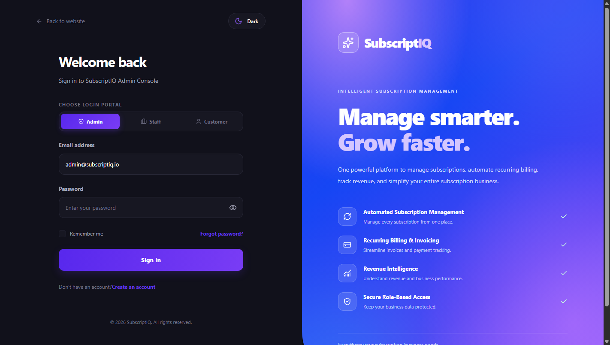
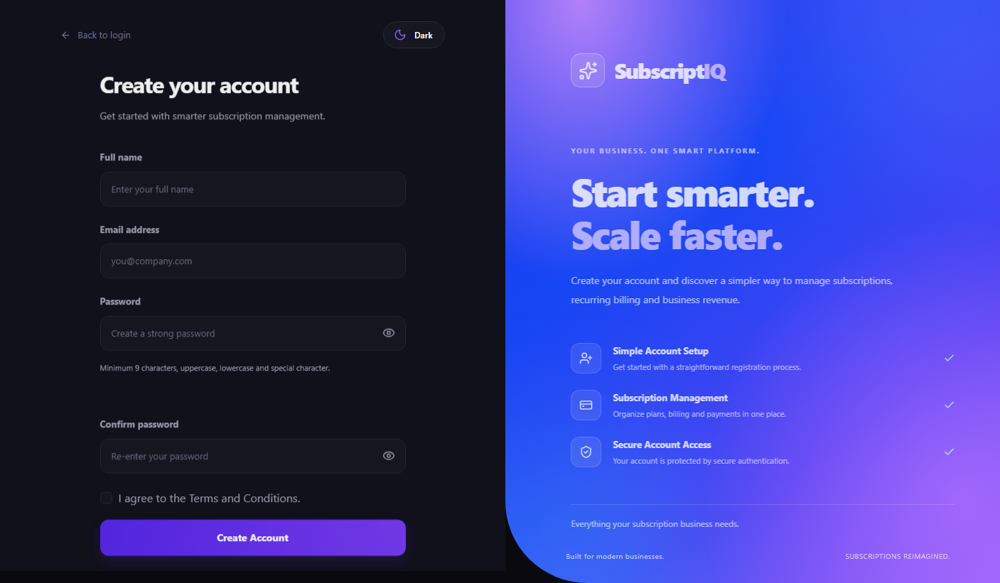
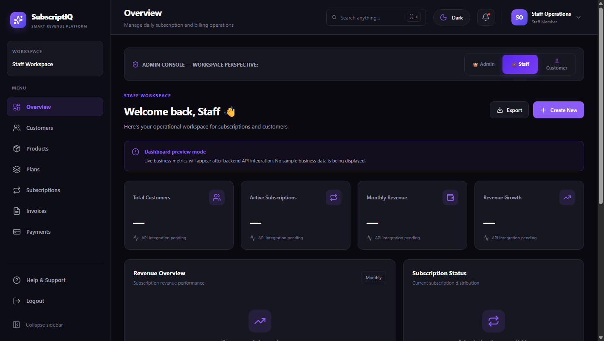
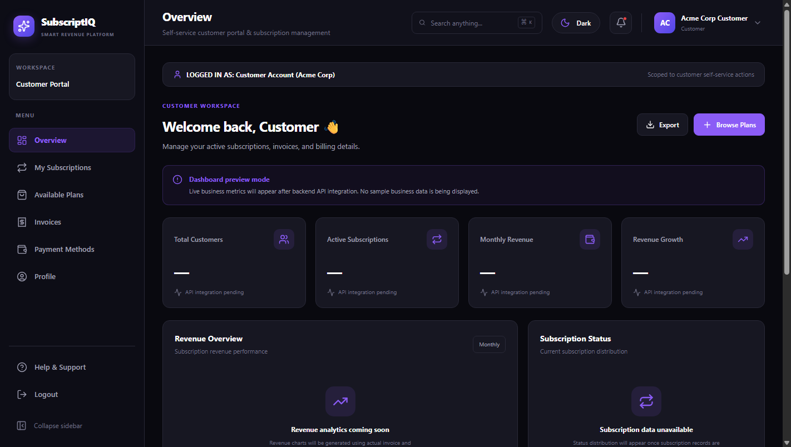
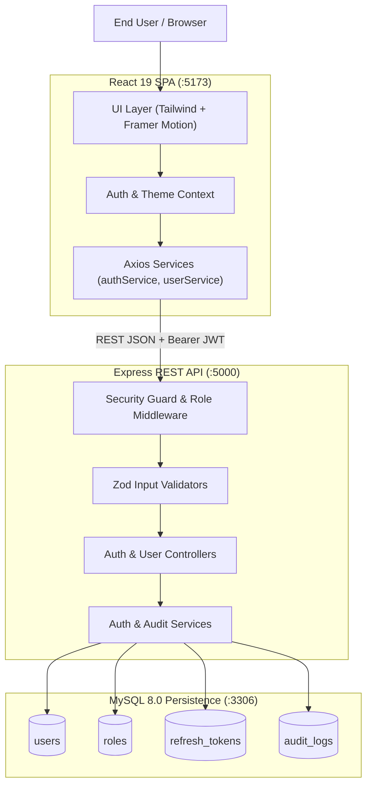

# SubscriptIQ — Intelligent Subscription & Revenue Management Platform

[](https://nodejs.org/)
[](https://react.dev/)
[](https://www.typescriptlang.org/)
[](https://www.mysql.com/)
[](LICENSE)
[]()

> **Odoo Hackathon / Make-A-Thon 9.0 Final Project Submission**  
> An intelligent, end-to-end platform for subscription lifecycles, recurring billing automation, role-based administration, and customer self-service.

---

## 1. Project Overview

Modern SaaS and digital recurring business models demand unified subscription orchestration, rigorous role separation, reliable billing reconciliation, and frictionless self-service experiences. Traditional enterprise ERP integrations often suffer from fragmented authentication, rigid customer interfaces, and complex deployment pipelines.

**SubscriptIQ** bridges this gap by delivering a unified, production-ready architecture designed specifically for the Odoo Hackathon / Make-A-Thon 9.0 challenge:
- A high-performance **React 19 / TypeScript** Single Page Application featuring tailored themes, smooth Framer Motion micro-interactions, and role-adaptive workspaces.
- A hardened **Node.js Express** backend incorporating robust JWT session orchestration, rotatable refresh tokens, and server-enforced Role-Based Access Control (RBAC).
- An ACID-compliant **MySQL** persistence layer tracking users, roles, password resets, refresh tokens, and audit events with parameterized queries and bcrypt password hashing.

---

## 2. Problem Statement & Proposed Solution

### The Problem
Growing businesses struggle with:
1. **Siloed Subscription Data**: Product catalogs, customer plans, and invoices frequently reside in disconnected tools, leading to billing discrepancies.
2. **Weak Access Boundaries**: Frontends that hide buttons without server-side validation leave sensitive customer data and administrative controls vulnerable to privilege escalation.
3. **Friction in Customer Onboarding**: Clunky sign-up workflows and opaque subscription management reduce customer retention.

### The SubscriptIQ Solution
- **Unified Role-Based Portals**:
  - **Admin Console**: Centralized organization oversight, customer directory, staff management, and billing configuration.
  - **Staff Operations Workspace**: Operational view for customer support, plan maintenance, and billing actions without exposure to critical system settings.
  - **Customer Portal**: Frictionless self-service for subscription discovery, account details, and invoice history.
- **Strict Cryptographic Security**: Zero plaintext passwords (`bcrypt` with 10 salt rounds), secure HttpOnly cookie tokens, and server-side RBAC middleware.
- **Direct Database Synchronization**: Live administrative tables querying MySQL via REST API contracts.

---

## 3. Platform Visual Showcase

| Multi-Role Authentication | Responsive Customer Registration (Light & Dark) |
| :---: | :---: |
|  |  |

| Admin Console & Live Directory | Customer Self-Service Portal View |
| :---: | :---: |
|  |  |

---

## 4. Key Platform Features

- **Multi-Role Authentication & Session Recovery**:
  - Real-time login with credentials validation for **ADMIN**, **STAFF**, and **CUSTOMER**.
  - Secure session restoration on browser refresh via `/api/auth/me`.
  - Automatic token cleanup and session termination on logout.
- **Self-Service Customer Registration**:
  - Enforced client-side and server-side Zod validation (minimum 9 characters, uppercase, lowercase, special character).
  - Duplicate email collision handling with HTTP 409 Conflict.
  - Strict role default preventing unauthorized privilege assignment.
- **Enterprise Role-Based Access Control (RBAC)**:
  - Express server-side middleware `requireRole('ADMIN')` rejecting unauthorized requests with HTTP 403.
  - Scoped UI perspectives dynamically tailored to the authenticated role.
- **Live MySQL Administrative Directory**:
  - Live customer and staff directory connected to MySQL via `/api/users`.
  - Real-time status badges, user IDs, and registration timestamps.
- **Modern User Experience**:
  - Instant Light/Dark theme switching with CSS variables.
  - Smooth Framer Motion transitions and fluid typography.
  - Honest status indicators for pending integration modules.

---

## 5. Technology Stack

### Frontend Architecture
- **Framework**: React 19, TypeScript 5.9, Vite 8
- **Styling**: Vanilla CSS Design System with Tailwind CSS utility tokens
- **Animations**: Framer Motion
- **Icons**: Lucide React
- **HTTP Client**: Axios with centralized request/response interceptors

### Backend & Security Architecture
- **Runtime & Server**: Node.js (v20+ / v24), Express.js (ES Modules)
- **Database Driver**: `mysql2/promise` with connection pooling
- **Validation**: Zod schema validation
- **Cryptography**: `bcrypt` (10 rounds), Node `crypto`
- **Security Middleware**: CORS, `cookie-parser` for HttpOnly tokens

### Persistence & Storage
- **Database Engine**: MySQL 8.0+
- **Schema Management**: Relational SQL migration scripts (`database/*.sql`)

---

## 6. System Architecture & Component Diagram



Detailed architectural diagrams, ER schemas, and sequence workflows are available in [docs/ARCHITECTURE.md](docs/ARCHITECTURE.md).

---

## 7. Quick Start & Setup Guide

### 7.1 Prerequisites
- Node.js v20+ / v24
- MySQL Server 8.0+ running on port `3306`

### 7.2 Database Setup
Create database and apply migrations:
```powershell
mysql -u root -p -e "CREATE DATABASE IF NOT EXISTS subscriptiq;"
mysql -u root -p subscriptiq < database/01_create_database.sql
mysql -u root -p subscriptiq < database/02_create_roles.sql
mysql -u root -p subscriptiq < database/03_create_users.sql
mysql -u root -p subscriptiq < database/04_password_reset_tokens.sql
mysql -u root -p subscriptiq < database/05_audit_logs.sql
mysql -u root -p subscriptiq < database/06_verify_database.sql
mysql -u root -p subscriptiq < database/07_auth_security_migration.sql
```

### 7.3 Backend Setup
```powershell
cd backend
npm install
cp .env.example .env
# Edit .env with your MySQL root password and secrets
node scripts/seed.js
npm run dev
```

### 7.4 Frontend Setup
```powershell
cd ../frontend
npm install
npm run dev
```

The application will be live at `http://localhost:5173`. Detailed instructions can be found in [docs/SETUP.md](docs/SETUP.md).

---

## 8. Pre-Seeded Test Credentials

| Role | Email | Password | Access Level |
| :--- | :--- | :--- | :--- |
| **ADMIN** | `admin@subscriptiq.io` | `AdminPassword1!` | Full platform administration & user directory |
| **STAFF** | `staff@subscriptiq.io` | `StaffPassword1!` | Operational billing & customer support workspace |
| **CUSTOMER** | `customer@acmecorp.com` | `CustomerPassword1!` | Self-service subscription management |

---

## 9. Comprehensive Testing & QA Results

To run the automated 26-point end-to-end integration test suite:
```powershell
cd backend
node scripts/verify-all.js
```

**Verification Results**:
- **Database & Passwords**: 100% bcrypt hashing verified, 0 plaintext passwords.
- **Authentication**: Admin, Staff, and Customer logins verified with token issuance.
- **Customer Registration**: Unique email constraint and password complexity verified.
- **RBAC Security Boundaries**: Customer and Staff unauthorized access to `/api/users` rejected with HTTP 403.
- **Production Build**: `npm run build` completed cleanly in 341ms with 0 TypeScript errors.

Full verification logs and test cases are documented in [docs/TEST_REPORT.md](docs/TEST_REPORT.md).

---

## 10. Documentation Index

- [docs/API_INTEGRATION.md](docs/API_INTEGRATION.md) — Comprehensive REST API documentation including active endpoints and contract definitions.
- [docs/ARCHITECTURE.md](docs/ARCHITECTURE.md) — Detailed system architecture, data models, and sequence diagrams.
- [docs/SETUP.md](docs/SETUP.md) — Step-by-step setup, configuration, and troubleshooting guide.
- [docs/TEST_REPORT.md](docs/TEST_REPORT.md) — Complete QA audit, test scenarios, and results matrix.

---

## 11. Known Limitations & Roadmap

In adherence to hackathon integrity and transparency guidelines:
- **SMTP Gateway**: When running locally without active SMTP credentials (`SMTP_HOST`), outgoing emails are safely held in the database without failing transactions.
- **Secondary CRUD Modules**: Foundations for Products, Plans, Subscriptions, and Invoices have schema definitions ready. Frontend tabs display verified empty/pending states until secondary business endpoints are deployed.
- **Roadmap**: Planned additions include Stripe/PayPal webhook integration, automated dunning email sequences, and multi-currency billing reconciliation.

---

## 12. Team & Contributions

Developed for the **Odoo Hackathon / Make-A-Thon 9.0**:

- **Thiru Mughil**: Frontend Architecture, UI/UX Engineering, Responsive Component Design, Theme System, Framer Motion Animations, Client State Management & Client API Services.
- **Kanishk**: Backend Architecture, Express API Endpoints, MySQL Schema Design, Database Migrations, Password Hashing, JWT/Session Strategy, and Audit Logging.

---

## 13. License

Distributed under the MIT License. See `LICENSE` for details.
