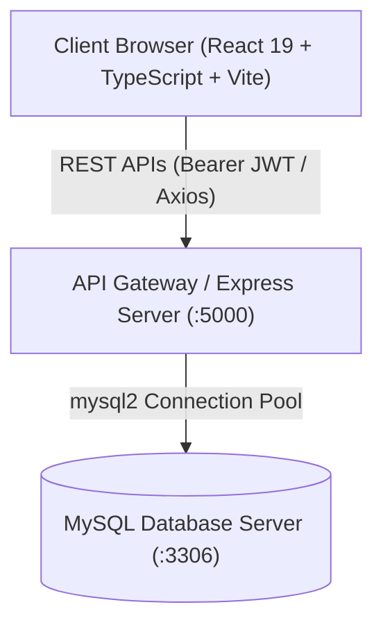
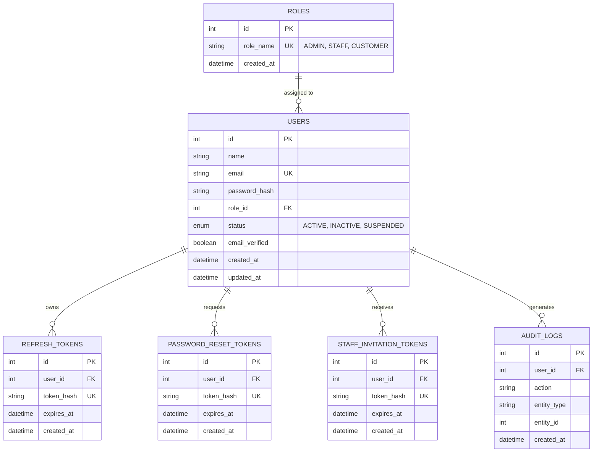
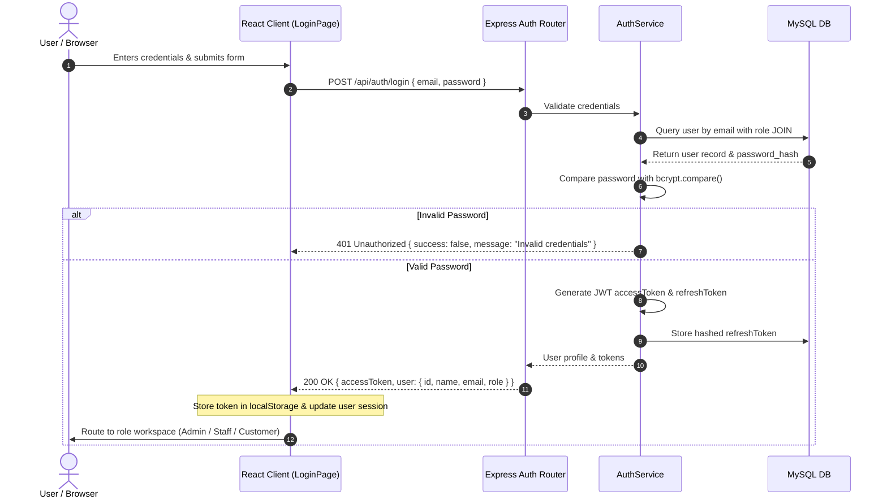

# SubscriptIQ System Architecture

## 1. Executive Architecture Summary

**SubscriptIQ** is an enterprise-grade subscription and recurring revenue management platform designed for SaaS and digital services businesses. The system is engineered around a decoupled client-server architecture consisting of a modern React/TypeScript Single Page Application (SPA), a RESTful Express.js microservice layer, and an ACID-compliant MySQL relational database.



---

## 2. Platform Layers

### 2.1 Frontend Client Layer (`/frontend`)
- **Framework**: React 19 with TypeScript and Vite 8 for sub-second hot reloading and optimized production bundles.
- **Styling & Design System**: Tailored Vanilla CSS design system enhanced with Tailwind CSS utility tokens, glassmorphism, responsive grid layouts, and native CSS variables for seamless Dark/Light theme switching.
- **Animations**: Framer Motion for portal switching transitions, dynamic role toggles, and modal dialogs.
- **State Management & Services**: Centralized Axios API client with automatic bearer token attachment, error interceptors, and typed domain services (`authService`, `userService`).
- **Client-Side Routing & RBAC**: Dynamic role-based view orchestration (Admin Console, Staff Operations Workspace, and Customer Self-Service Portal).

### 2.2 Backend Service Layer (`/backend`)
- **Runtime**: Node.js (v20+ / v24) with ES Modules.
- **Framework**: Express.js with a modular controller-service-repository pattern.
- **Security & Hardening**:
  - `cors`: Configured for origin validation (`http://localhost:5173`).
  - `cookie-parser`: Secure handling of HttpOnly refresh tokens.
  - `zod`: Strict schema validation on incoming payloads before reaching business services.
  - `bcrypt`: Password hashing utilizing 10 salt rounds.
  - `crypto`: Cryptographically secure token generation for password resets and staff invites.
- **Authentication Strategy**:
  - Short-lived JSON Web Tokens (JWT) for stateless API authentication.
  - Rotatable refresh tokens stored in MySQL for long-lived session persistence.
  - Server-side role guard middleware (`requireRole('ADMIN')`, `authenticateToken`).

### 2.3 Persistence Layer (`/database`)
- **Database Engine**: MySQL 8.0+ / MariaDB.
- **Connection Management**: `mysql2/promise` connection pooling with automatic reconnection and transaction support (`beginTransaction`, `commit`, `rollback`).
- **Audit Trails**: Built-in `audit_logs` tracking sensitive administrative and membership events.

---

## 3. Data Architecture & Relational Schema



---

## 4. Authentication & RBAC Security Workflow



---

## 5. Role-Based Access Control (RBAC) Hierarchy

| Role | Intended Workspace | Permissions & Scopes |
| :--- | :--- | :--- |
| **ADMIN** | Admin Console | Full organization visibility: read/write all users, staff invitations, system metrics, product/plan catalog, subscriptions, invoices, and audit logs. |
| **STAFF** | Staff Workspace | Operational scope: manage customer accounts, product/plan configurations, subscription lifecycles, invoices, and payments. Cannot access admin-only endpoints. |
| **CUSTOMER** | Customer Portal | Self-service scope: manage personal subscription, view billing history, update payment methods, download invoices. Strictly forbidden from viewing other customers' records. |

---

## 6. Directory Structure Overview

```
ODOO-Hackathon/
├── backend/                  # Express REST API
│   ├── scripts/              # Seed, migration, and verification scripts
│   ├── src/
│   │   ├── config/           # Database pool configuration
│   │   ├── controllers/      # Route controllers (auth, user)
│   │   ├── middleware/       # Auth, role guard, error handling
│   │   ├── routes/           # Express routers (/api/auth, /api/users, /api/admin)
│   │   ├── services/         # Business logic (auth, audit, email)
│   │   ├── utils/            # ApiResponse formatting, token utilities
│   │   ├── validators/       # Zod schemas for input validation
│   │   ├── app.js            # Express app setup & middleware
│   │   └── server.js         # HTTP server entry point (:5000)
│   ├── .env.example          # Environment variables template
│   └── package.json
│
├── database/                 # SQL schemas & migrations
│   ├── 01_create_database.sql
│   ├── 02_create_roles.sql
│   ├── 03_create_users.sql
│   ├── 04_password_reset_tokens.sql
│   ├── 05_audit_logs.sql
│   ├── 06_verify_database.sql
│   └── 07_auth_security_migration.sql
│
├── frontend/                 # React 19 TypeScript Vite application
│   ├── public/               # Favicon and SVGs
│   ├── src/
│   │   ├── components/       # Layout, ThemeToggle, PlaceholderView
│   │   ├── layouts/          # DashboardLayout (topbar + sidebar)
│   │   ├── pages/
│   │   │   ├── admin/        # AdminDashboard (multi-perspective workspace)
│   │   │   └── auth/         # LoginPage, RegisterPage, ForgotPasswordPage
│   │   ├── services/         # Centralized Axios API client & domain services
│   │   ├── App.css           # Design tokens, themes, layout styles
│   │   ├── App.tsx           # Session restore & role router
│   │   └── main.tsx          # Application entry point
│   └── package.json
│
├── docs/                     # Documentation suite
│   ├── API_INTEGRATION.md    # REST API specification
│   ├── ARCHITECTURE.md       # System design & ER diagrams
│   ├── SETUP.md              # Installation & configuration manual
│   └── TEST_REPORT.md        # Comprehensive QA & test report
│
├── .gitignore                # Production ignore rules
└── README.md                 # Primary submission document
```
